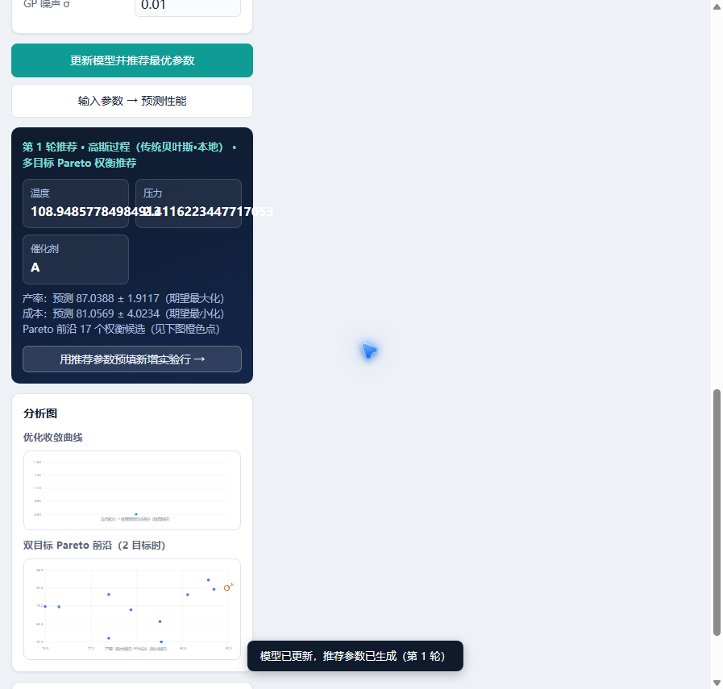

# 实验参数优化迭代工具 · Bayesian Experimental Parameter Optimizer

> 一个**实验数据驱动的贝叶斯优化迭代工具**：加入实验数据 → 更新模型 → 得到下一组最优参数建议。
> A lightweight, pure-frontend Bayesian optimization tool for iterative experiment / industrial process parameter tuning.

纯网页前端、零安装：**高斯过程（传统贝叶斯）在浏览器本地计算**，支持多目标优化（Pareto 前沿）、CSV / Excel 数据导入即替换。

## ✨ 功能特性

- 🧪 **高斯过程（GP，传统贝叶斯优化）**：RBF 核 GP 回归 + EI / UCB 采集函数，全部在浏览器本地计算
- 🎯 **多目标优化**：候选空间采样 → GP 预测 → 非支配排序提取 Pareto 前沿 → 推荐 knee 权衡最优解
- 🔄 **迭代闭环**：推荐参数 → 做实验 → 加入实测结果 → 更新模型 → 新一轮推荐
- 📊 **数据导入即替换**：支持 **CSV / XLSX / XLS**，自动读取表头——数字列自动设为参数范围、文本列自动设为类别、末列自动设为目标；无论当前配置如何，导入即按文件表头重建配置并替换数据集
- 🖥️ **零安装零依赖**：双击 HTML 即可使用，无需 Python、无需联网，数据不离开本机
- 📈 内联可视化：优化收敛曲线、双目标 Pareto 前沿图、迭代历史

## 🚀 快速开始

```bash
git clone <你的仓库地址>
cd 实验数据最优化工具
# 直接双击打开 实验参数优化工具.html 即可，无需任何安装
```

> ⚠️ 注意：`lib/xlsx.full.min.js`（Excel 解析库）必须与 HTML 保持同一目录，请保留整个项目文件夹。

## 🖼️ 界面预览



## 📥 数据格式

支持 **CSV / XLSX / XLS**，首行为表头，例如：

```
温度,压力,催化剂,产率,成本
30,3,A,78.5,59.1
60,7,B,82.2,66.4
90,5,A,85.7,84.5
```

- 参数列：数字（自动取范围）或文本（自动取类别）
- 目标列：必须是数字（末列默认设为目标，方向可在左侧调整）
- 导入即替换：导入后左侧参数/目标配置自动按文件表头重建，现有数据集整体替换
- CSV 需 UTF-8 编码（Excel「另存为」默认 GBK 时会提示转换）

## 🧠 优化算法

| 算法 | 说明 |
|---|---|
| **高斯过程（GP）** | 浏览器本地实现 RBF 核高斯过程回归 + EI（期望改进）/ UCB（上置信界）采集函数 |
| **多目标 Pareto** | 候选空间采样 → 各目标代理预测 → 非支配排序 → 推荐 knee 点（距理想点最近的权衡最优） |
| **XGBoost / LightGBM**（可选扩展） | 见 `server/` 参考脚本，可在 VSCode 中实现并接入 |

## 📁 目录结构

```
实验数据最优化工具/
├── 实验参数优化工具.html   # 主应用（单文件纯前端，核心交付物）
├── 使用说明.md              # 详细使用说明
├── 界面预览.png             # README 截图
├── lib/
│   └── xlsx.full.min.js     # SheetJS Excel 解析库（本地，离线可用）
├── server/
│   └── server.py            # XGBoost / LightGBM 参考实现（可选，供二次开发）
├── data/                    # 运行时数据目录（已 gitignore，仅占位）
├── requirements.txt         # server.py 可选依赖
├── LICENSE                  # MIT License
└── .gitignore
```

## 🔧 二次开发（XGBoost / LightGBM）

当前页面只包含高斯过程。如需接入 XGBoost / LightGBM：

1. 参考 `server/server.py`（含 XGB/LGB 训练、推荐、Pareto、预测的完整实现）
2. 在 VSCode 中实现脚本后，参照原后端 API 结构把模型选项加回前端
3. 依赖安装：`pip install -r requirements.txt`

## 📄 License

[MIT](LICENSE) © 2026
